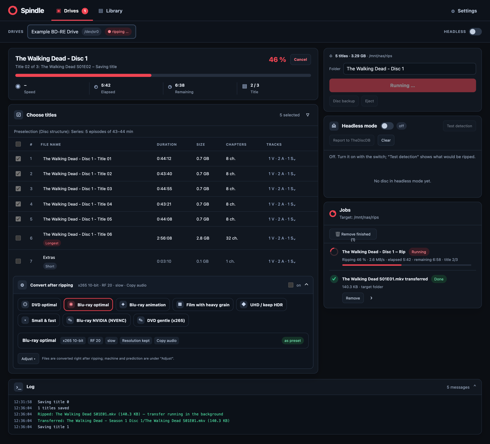
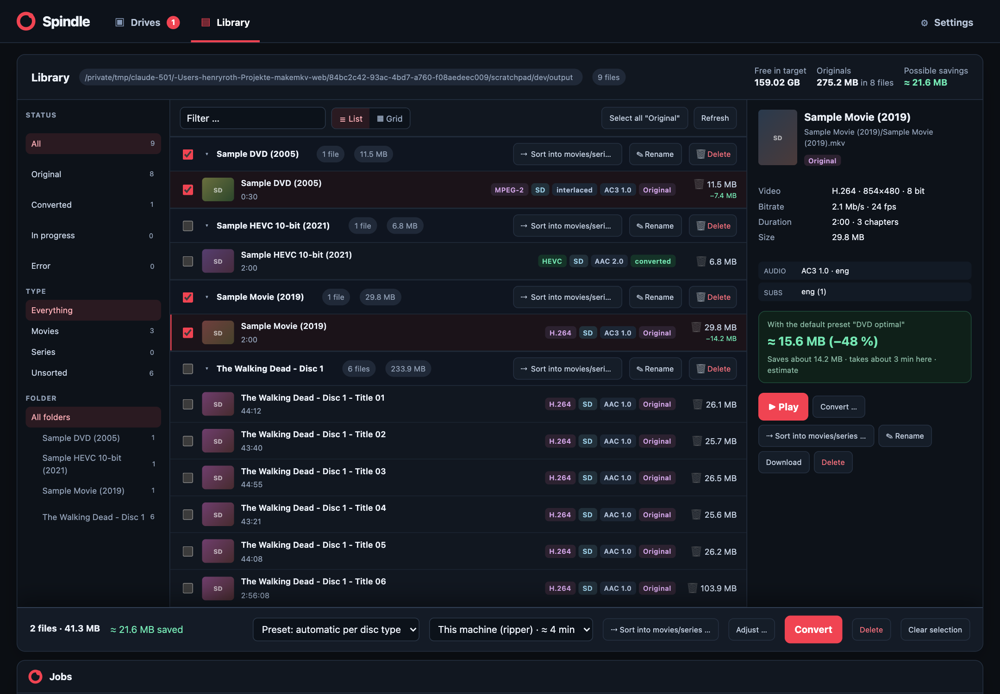

# Spindle

A browser interface around [MakeMKV](https://www.makemkv.com/) for a headless server. Plug a USB/SATA drive into a
server and insert a disc – it is detected live and analyzed automatically, and everything else (choosing titles,
ripping, converting, sorting into your Jellyfin library, ejecting) happens in the browser.



## What MakeMKV does and what Spindle adds

Spindle does not read or decrypt discs itself. That is MakeMKV's work – Spindle runs `makemkvcon` in the background
and builds everything else around it.

| | Provided by |
|---|---|
| Reading DVDs, Blu-rays and UHD Blu-rays, decryption (AACS/BD+/CSS) | **MakeMKV** |
| Title and track list of a disc (duration, size, chapters, audio/subtitle tracks) | **MakeMKV** |
| Ripping titles to MKV, decrypted disc backup (BDMV/VIDEO_TS) | **MakeMKV** |
| Selecting audio/subtitle languages when ripping | **MakeMKV** (Spindle writes its settings) |
| Web interface, live detection of drives and discs (insert, eject, unplug), auto-eject | Spindle |
| Title preselection and headless mode (memory of earlier choices, [TheDiscDB](https://thediscdb.com), TMDB runtimes, disc structure) | Spindle |
| Staging buffer and background transfer to a NAS, recovery after USB resets of the drive | Spindle |
| Conversion with ffmpeg (x265/x264/SVT-AV1/hardware, presets, forecast, test encode, segments in parallel) | Spindle |
| Library, built-in player, sorting into Jellyfin folders with TMDB, undo | Spindle |
| Cluster of several machines (discovery, pairing, hand-over of conversions, remote drives) | Spindle |

### Support MakeMKV

Spindle would not exist without MakeMKV. MakeMKV is shareware: DVDs are free, Blu-ray support needs a registration
key after the 30-day trial (the public beta key works in the meantime). If Spindle is useful to you, please consider
supporting MakeMKV's developer by [buying a registration key](https://www.makemkv.com/buy/) – that is the way to
contribute to MakeMKV; there is no separate donation page. The same links are in the interface under
Settings › MakeMKV key and Settings › About.

## Features

- Live detection of drive and disc (insert, eject, unplug)
- Automatic analysis of newly inserted discs (DVD / Blu-ray)
- Title list with duration, size, chapters and tracks; file names and target folder are editable
- Rip as MKV or as a decrypted disc backup, progress with remaining time, cancel, log
- Language filter for audio/subtitles, auto-eject
- Staging buffer: every title is ripped locally first and transferred to the target (e.g. a NAS) in the background once it is finished, while the next title is already ripping – a slow network does not slow the rip down
- Conversion after ripping or later from the library (ffmpeg): presets (DVD/Blu-ray optimal, animation, film grain, UHD/HDR, small & fast, NVIDIA), codecs x265/x264/SVT-AV1 and hardware encoders, size and duration forecast per machine, test encode with a before/after comparison, warning for Dolby Vision; large movies are split into segments according to free cores/RAM and encoded in parallel
- Library with filters, list/grid view, detail pane and selection bar; converted files replace the original once the check passes; lock files keep two instances from working on the same file
- Built-in browser player (direct, remux or transcode, subtitles, seeking)
- Sorting into Jellyfin folders (movies/series) with TMDB search, plan, undo and optional automation
- Several machines in a cluster: discovery on the network, pairing via token, hand-over of conversions, remote control of drives
- Output to a mounted network share (NFS/SMB), with a local fallback
- Survives USB resets of the drive (waits and repeats the step automatically)
- Headless mode: insert a disc, done – the right titles (main feature or episodes) are determined from its own memory (formerly picked by hand), TheDiscDB, TMDB runtimes or the structure of the disc, ripped, and the disc is ejected; unknown discs can be reported to TheDiscDB



## Installation

Requirement: Linux with Docker + the Compose plugin.

```bash
git clone https://github.com/SloppyHenry/spindle && cd spindle
./install.sh
```

The script loads `sg`/`sr_mod`, creates `.env`, asks for the MakeMKV EULA, determines the **latest MakeMKV version**
from makemkv.com, builds the image and starts the container. Afterwards: `http://<server>:8780`.

To update (new MakeMKV version, e.g. because the beta expires after 60 days): simply run `./install.sh` again.

## Configuration (`.env`)

| Variable | Meaning |
|---|---|
| `PORT` | Web port (8780) |
| `PUID`/`PGID` | Owner of the ripped files |
| `CDROM_GID` | The host's `cdrom` group |
| `RENDER_GID` | The host's `render` group (only for hardware encoding via `/dev/dri`) |
| `NVIDIA` | `auto` (default): pass an NVIDIA card through to the container (NVENC) if Docker knows it via CDI (NVIDIA Container Toolkit, device `nvidia.com/gpu=all`); `install.sh` then sets `COMPOSE_FILE` to `docker-compose.yml:docker-compose.nvidia.yml`. `no` = never |
| `NAS_MOUNT` | Path of the mounted target on the host |
| `OUTPUT_DIR` | Output folder (below `NAS_MOUNT`); if `NAS_MOUNT` is not mounted, files are stored locally in `data/output` |
| `AUTH_USER`/`AUTH_PASS` | Optional password protection (HTTP Basic). Without `AUTH_PASS` the interface is open |
| `STAGING_PATH` | Local staging buffer (default `data/staging`); needs room for the largest title (about 50 GB for Blu-ray, more with conversion) |
| `HIDE_DRIVES` | Regex for drives that are not shown (default: `cdemu\|virtual\|qemu\|vbox`, empty = show all) |
| `INSTANCE_NAME` | Name of this instance (appears in lock files; `install.sh` sets the hostname) |
| `MKV_VERSION` | `latest` or a fixed version |

NFS example (`/etc/fstab`, without automount so that Docker can bind the path):

```
192.0.2.10:/export/data /mnt/nas nfs4 rw,nofail,_netdev,x-systemd.mount-timeout=20 0 0
```

## Notes

- **MakeMKV** is partly open source (GPL/LGPL), but `makemkv-bin` is proprietary. This repo contains no MakeMKV;
  it is downloaded from makemkv.com at build time. The [EULA](https://www.makemkv.com/eula/) applies to you.
- Without a key of your own, the app uses the public beta key from the [MakeMKV forum](https://forum.makemkv.com/forum/viewtopic.php?f=5&t=1053).
  Your own key: settings in the interface.
- Without `AUTH_PASS` the interface has **no login** – anyone who can reach it can rip and delete files. Run it only on a trusted LAN and never expose it unprotected to the internet. Even with a password: make it reachable from outside only over HTTPS/VPN.
- Copy only your own discs and only as far as applicable law allows (circumventing copy protection is restricted in some countries).

## Layout

- `app/` – Python package (FastAPI): `main.py` (app, routers, startup), `drives.py`, `rip.py`, `upload.py`, `convert.py`/`ffmpeg.py`, `library*.py`, `cluster.py`, `nodes*.py` (machines), `player*.py`, `media/` (Jellyfin filing), `headless/` (headless mode), `convert*.py` (conversion), `files.py`, `settings.py`, `state.py`, `ext.py` (extension points) and others
- `app/static/` – interface without a build step: `index.html`, `css/`, `js/` (native ES modules; `registry.js` holds the extension points)
- `Dockerfile` · `docker-compose.yml` · `install.sh`
- Details, interfaces and conventions: [docs/agents/schnittstellen.md](docs/agents/schnittstellen.md)

## Development

Locally without Docker, without a drive and without a NAS: `scripts/dev.sh` starts the app on http://127.0.0.1:8790 with sample files and a fake drive (`scripts/dev.sh pair` starts two instances in a cluster, `scripts/dev.sh --help` shows all options). Requires Python 3.10 or newer and ffmpeg; missing Python packages are installed by the script into its own virtual environment.

Tests: `python -m unittest discover -s tests -t .` (needs `fastapi` and `ffmpeg`; also run by CI on Linux and macOS).

## License

MIT (see [LICENSE](LICENSE)). MakeMKV is a product of GuinpinSoft inc; this project is not affiliated with MakeMKV or endorsed by its maker.
